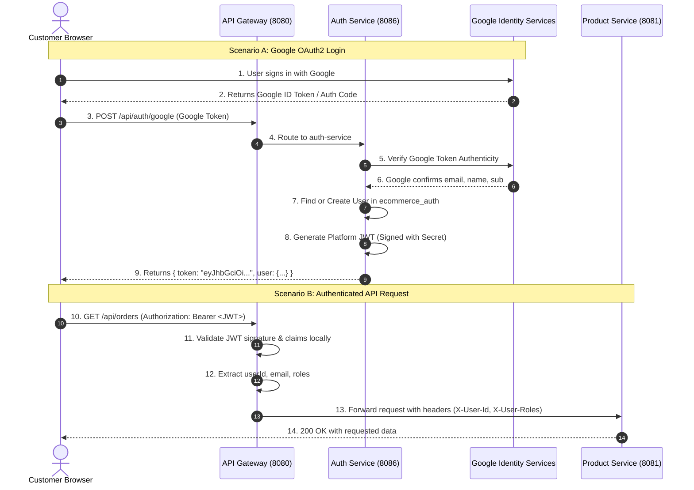
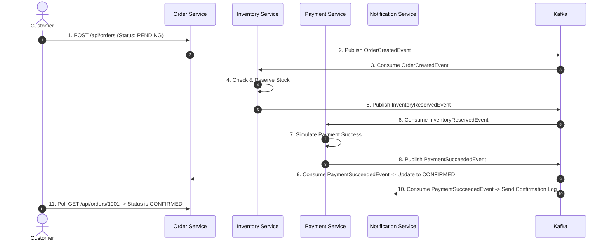
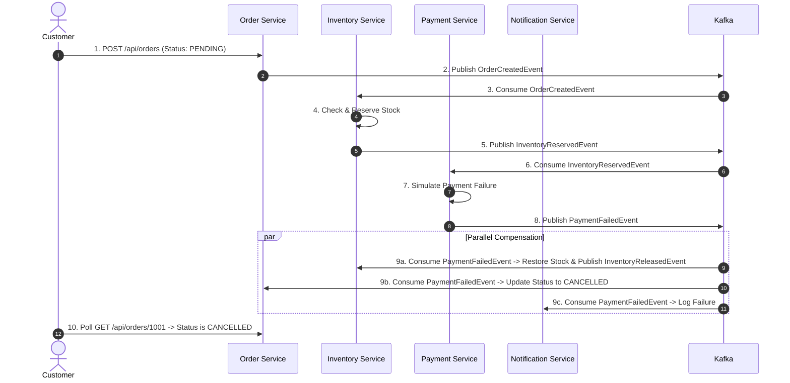

# ARCHITECTURE.md — System Architecture & Design Specifications

## 1. High-Level Architecture Overview

This application is built as an **Event-Driven Distributed Microservices System** using the **Choreography-based Saga Pattern**. The system separates read-heavy operations (product browsing with Redis cache-aside) from transactional write operations (order placement, inventory reservation, and payment processing with Apache Kafka).

```
 +-------------------------------------------------------------------------------+
 |                              REACT FRONTEND                                   |
 |                   (Vite, React Router, Redux Toolkit)                         |
 |                       Runs on http://localhost:5173                           |
 +---------------------------------------+---------------------------------------+
                                         | HTTP / REST (JWT in Bearer Header)
                                         v
 +-------------------------------------------------------------------------------+
 |                         SPRING CLOUD API GATEWAY                              |
 |                         Runs on http://localhost:8080                         |
 |   - Global CORS Handling                                                      |
 |   - Route Mapping to Internal Microservices                                   |
 |   - Reactive JWT Authentication Filter & Claim Extraction                     |
 |   - Header Forwarding: X-User-Id, X-User-Email, X-User-Roles                  |
 +-------+------------+------------+-------------+---------------+---------------+
         |            |            |             |               |               |
         v            v            v             v               v               v
    +---------+  +---------+  +---------+   +---------+     +---------+     +---------+
    |  auth   |  | product |  |  order  |   |inventory|     | payment |     |notificat|
    | service |  | service |  | service |   | service |     | service |     | service |
    |  :8086  |  |  :8081  |  |  :8082  |   |  :8083  |     |  :8084  |     |  :8085  |
    +----+----+  +----+----+  +----+----+   +----+----+     +----+----+     +----+----+
         |            |            |             |               |               |
       MySQL        MySQL        MySQL         MySQL           MySQL           MySQL
    (auth_db)   (product_db)  (order_db)  (inventory_db)   (payment_db)   (notif_db)
                      |
                    Redis
                   (Cache)
```

---

## 2. Microservice Boundaries & Responsibilities

| Service Name | Port | Primary Responsibility | Data Store | Inbound Communication | Outbound Communication |
| :--- | :---: | :--- | :--- | :--- | :--- |
| **api-gateway** | `8080` | Reverse proxy, route dispatching, global CORS, JWT token verification, security header forwarding. | None (Stateless) | HTTP from Browser | HTTP to internal services |
| **auth-service** | `8086` | User registration, credential authentication, Google OAuth2 token verification, JWT issuance. | MySQL (`ecommerce_auth`) | HTTP via Gateway | None |
| **product-service**| `8081` | Product catalog, category management, Redis cache-aside read acceleration, admin inventory hooks. | MySQL (`ecommerce_product`) + Redis | HTTP via Gateway | Redis Cache read/write |
| **order-service** | `8082` | Order checkout submission, order state machine (`PENDING`, `CONFIRMED`, `CANCELLED`), order retrieval. | MySQL (`ecommerce_order`) | HTTP via Gateway & Kafka Topics | Kafka (`order-created-events`) |
| **inventory-service**| `8083`| Stock level tracking, optimistic locking, stock reservation, stock release compensation. | MySQL (`ecommerce_inventory`) | HTTP via Gateway & Kafka Topics | Kafka (`inventory-reserved`, `inventory-rejected`, `inventory-released`) |
| **payment-service**| `8084` | Simulated payment processing, payment authorization/rejection, audit transaction records. | MySQL (`ecommerce_payment`) | Kafka (`inventory-reserved-events`) | Kafka (`payment-succeeded`, `payment-failed`) |
| **notification-service**| `8085`| Notification audit logs, order confirmation alerts, customer messaging simulator. | MySQL (`ecommerce_notification`) | Kafka (all status events) | HTTP for audit logs |

---

## 3. Database Ownership & Isolation Principles

To uphold microservice decoupling, each microservice owns its private database schema. **Cross-service foreign keys and direct SQL joins between microservice databases are strictly prohibited.**

```
+-----------------------------------------------------------------------------------------+
|                                    MYSQL INSTANCE                                       |
|                               (Exposed on Host: 3309)                                   |
|                                                                                         |
|  +--------------------+  +----------------------+  +--------------------+               |
|  |   ecommerce_auth   |  |  ecommerce_product   |  |  ecommerce_order   |               |
|  |  - users           |  |  - products          |  |  - orders          |               |
|  |  - roles           |  |  - categories        |  |  - order_items     |               |
|  +--------------------+  +----------------------+  +--------------------+               |
|                                                                                         |
|  +--------------------+  +----------------------+  +--------------------+               |
|  |ecommerce_inventory |  |  ecommerce_payment   |  | ecommerce_notif    |               |
|  |  - inventory_items |  |  - payments          |  |  - notifications   |               |
|  |  - stock_history   |  |  - transactions      |  |  - email_logs      |               |
|  +--------------------+  +----------------------+  +--------------------+               |
+-----------------------------------------------------------------------------------------+
```

### Shared References
- `order-service` stores `productId`, `productName`, and `unitPrice` at the time of purchase as historical value objects, avoiding queries to `product-service` when viewing past orders.
- `inventory-service` tracks inventory by `productId` and `sku`.

---

## 4. Authentication Architecture: Google OAuth2 + JWT Explained

### Why Both Google OAuth2 and JWT are Used
A common question in Java Full-Stack interviews is: *"Why do you use both OAuth2 and JWT? Aren't they competing technologies?"*

**The Answer:**
- **OAuth2 is an Authorization / Delegation Protocol**: It allows users to authenticate using an external trusted Identity Provider (Google) without sharing their Google passwords with our application.
- **JWT (JSON Web Token) is a Compact, Self-Contained Token Format**: It represents authenticated user claims (`userId`, `email`, `roles`) cryptographically signed by our backend.
- **How they work together**:
  1. Google handles user identity verification via OAuth2.
  2. Once Google verifies the user, our backend exchanges or validates the Google token and generates our **own platform JWT**.
  3. Our internal microservices and API Gateway only need to verify our platform JWT. They do **not** need to call Google's servers on every subsequent API request. This prevents external API rate limits, minimizes latency, and keeps all downstream microservices decoupled from external providers.



---

## 5. Event-Driven Choreography Saga

### 5.1 Kafka Topics & Contracts

All domain events are serialized as JSON records. Kafka topic keys are consistently set to `orderId` to guarantee partition ordering for a given order.

#### 1. Topic: `order-created-events`
- **Published by**: `order-service`
- **Consumed by**: `inventory-service`, `notification-service`
- **Payload Schema**:
  ```json
  {
    "eventId": "c3b93478-f3d2-4e4b-970d-0348a2dc349b",
    "eventType": "ORDER_CREATED",
    "orderId": 1001,
    "customerId": 42,
    "customerEmail": "customer@example.com",
    "totalAmount": 129.98,
    "items": [
      {
        "productId": 5,
        "sku": "TECH-KB-01",
        "quantity": 2,
        "unitPrice": 64.99
      }
    ],
    "timestamp": "2026-10-29T10:15:30Z"
  }
  ```

#### 2. Topic: `inventory-reserved-events`
- **Published by**: `inventory-service`
- **Consumed by**: `payment-service`, `notification-service`
- **Payload Schema**:
  ```json
  {
    "eventId": "f7a22830-1c39-44e2-8921-5a0247df6023",
    "eventType": "INVENTORY_RESERVED",
    "orderId": 1001,
    "customerId": 42,
    "customerEmail": "customer@example.com",
    "totalAmount": 129.98,
    "reservedItems": [
      {
        "productId": 5,
        "sku": "TECH-KB-01",
        "quantity": 2
      }
    ],
    "timestamp": "2026-10-29T10:15:32Z"
  }
  ```

#### 3. Topic: `inventory-rejected-events`
- **Published by**: `inventory-service`
- **Consumed by**: `order-service`, `notification-service`
- **Payload Schema**:
  ```json
  {
    "eventId": "893df021-992a-44e3-a5b6-764988710fae",
    "eventType": "INVENTORY_REJECTED",
    "orderId": 1001,
    "reason": "Insufficient stock for product ID 5 (SKU TECH-KB-01)",
    "timestamp": "2026-10-29T10:15:32Z"
  }
  ```

#### 4. Topic: `payment-succeeded-events`
- **Published by**: `payment-service`
- **Consumed by**: `order-service`, `notification-service`
- **Payload Schema**:
  ```json
  {
    "eventId": "3c847bb2-4112-401f-bf48-18e3c983a54b",
    "eventType": "PAYMENT_SUCCEEDED",
    "orderId": 1001,
    "paymentId": 501,
    "transactionReference": "TXN-9843-SIMULATED",
    "amount": 129.98,
    "timestamp": "2026-10-29T10:15:34Z"
  }
  ```

#### 5. Topic: `payment-failed-events`
- **Published by**: `payment-service`
- **Consumed by**: `order-service`, `inventory-service` (triggers compensation), `notification-service`
- **Payload Schema**:
  ```json
  {
    "eventId": "18cf3291-5801-443b-8ea9-42b87b7a2f1c",
    "eventType": "PAYMENT_FAILED",
    "orderId": 1001,
    "reason": "Simulated payment failure (Insufficient funds)",
    "timestamp": "2026-10-29T10:15:34Z"
  }
  ```

#### 6. Topic: `inventory-released-events` (Compensation Event)
- **Published by**: `inventory-service`
- **Consumed by**: `notification-service`
- **Payload Schema**:
  ```json
  {
    "eventId": "59b40f28-d893-4e4b-970d-8392a2dc349b",
    "eventType": "INVENTORY_RELEASED",
    "orderId": 1001,
    "releasedItems": [
      {
        "productId": 5,
        "quantity": 2
      }
    ],
    "timestamp": "2026-10-29T10:15:35Z"
  }
  ```

---

### 5.2 Happy Path Sequence (Successful Purchase)



---

### 5.3 Failure Compensation Sequence (Payment Failed -> Stock Released)



---

## 6. Redis Caching Architecture

Product catalog browsing accounts for ~90% of requests in e-commerce systems. `product-service` utilizes the **Cache-Aside Pattern** via Spring Data Redis:

1. **Read Request (`GET /api/products`)**:
   - Check Redis key `products::page_0_cat_all`.
   - **Cache HIT**: Return cached JSON payload directly (response time ~5-15ms).
   - **Cache MISS**: Query MySQL `ecommerce_product`, serialize result to Redis with a 15-minute TTL, and return to caller.
2. **Write Request (`POST /api/products` or `PUT /api/products/{id}`)**:
   - Update MySQL record.
   - Execute `@CacheEvict(value = "products", allEntries = true)` to ensure stale catalog items are immediately invalidated.

---

## 7. Idempotency & Fault Tolerance

1. **At-Least-Once Kafka Delivery**:
   - Kafka guarantees at-least-once message delivery. A message may be redelivered during consumer restarts or network hiccups.
2. **Idempotent Consumers**:
   - In `order-service`, if a `PaymentSucceededEvent` is received for an order that is already in `CONFIRMED` status, the listener logs an informational note and safely discards duplicate processing.
   - In `inventory-service`, compensation operations check whether stock for `orderId` has already been released to avoid duplicate restocking.
3. **Idempotency in Notification Service**:
   - `notification-service` persists an immutable `event_id` in `notification_logs` with a unique database constraint (`uk_notification_event_id`). Duplicate Kafka events are evaluated by `existsByEventId` and any race conditions are caught via `DataIntegrityViolationException`, preventing double logging.
4. **Optimistic Locking**:
   - `inventory-service` uses JPA `@Version` on `inventory_items` to prevent lost updates when concurrent orders compete for stock.
